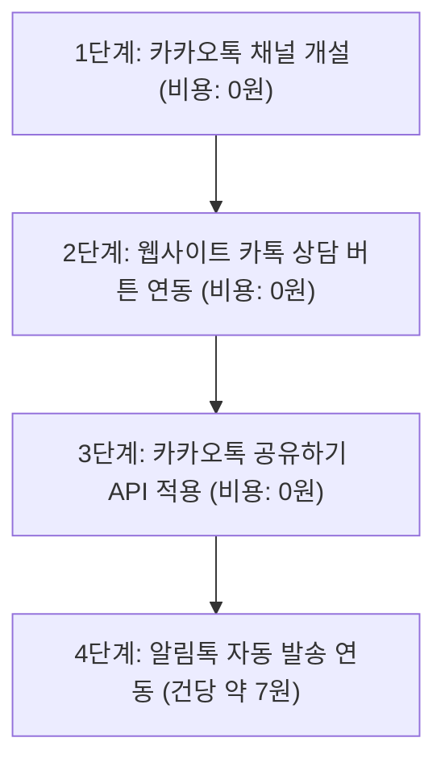

# kakao_talk.md — 용달코리아(ydkorea.co.kr) 카카오톡 연계 전략 및 도입 가이드

> 이 문서는 용달코리아 사이트 및 고객 상담 시스템에 **카카오톡(KakaoTalk) 서비스를 성공적으로 연계하기 위한 비즈니스 효과, 세부 연계 방식, 실제 소요 비용, 웹사이트 UI/UX 적용 가이드**를 정리한 공식 기획 문서입니다.

---

## 1. 카카오톡 연계 개요 & 도입 배경

용달·화물·이사 운송 서비스는 고객이 화물의 규격(가로/세로/높이)과 이삿짐 양을 전화상으로 정확하게 설명하기 어렵고, 최근 20~40대 1인 가구 및 스마트폰 중심 사용자들의 **전화 통화 기피 현상(콜포비아)**이 뚜렷해지고 있습니다.

카카오톡을 웹사이트([/v2-1/](file:///c:/git_works/yongdal/ydkorea/v2-1))와 연계함으로써 **"짐 사진 전송을 통한 1초 맞춤 견적"**을 실현하고, 고객 이탈 방지와 전환율(CVR) 극대화를 달성할 수 있습니다.

---

## 2. 카카오톡 연계 4대 핵심 비즈니스 효과

### 1) 📸 "짐 사진 전송"으로 1초 만에 정확한 견적 산출 (가장 강력한 무기)
- **전화 상담의 한계**:
  - *"책상이 가로 몇 cm인가요? 박스가 대략 몇 개 나오나요? 침대 매트리스는 분리되나요?"*
  - 통화가 5~10분 이상 길어지며, 고객의 주관적인 설명으로 현장에서 차량 적재함이 부족하거나 추가 요금 분쟁이 발생함.
- **카톡 연계 효과**:
  - **"고객님, 방 안 짐 사진 2~3장만 찍어서 카톡으로 톡 보내주세요."**
  - 사진 한 장으로 차주 및 본사 상담원이 차량 종류(1t 카고/탑차/리프트)와 기사 인력 동참 필요 여부를 즉각 정확하게 산출.

### 2) 📱 20~40대 1인가구/원룸/자취생의 "전화 기피(콜포비아)" 해결
- 원룸 이사, 소형 소호 사무실, 학생 이사 등 핵심 이용층은 낯선 번호와의 전화 통화보다 모바일 메신저를 압도적으로 선호.
- 대중교통 이용 중, 직장 근무 시간, 야간/새벽 시간대에도 사이트 이탈 없이 **[카톡 1초 상담]**으로 유입되어 견적 리드로 연결.

### 3) 📍 주소·연락처 오타 및 배차 사고 원천 방지
- 출발지·도착지의 상세 주소(동·호수, 엘리베이터 유무, 사다리차 진입 가능 여부)를 카톡 텍스트로 보존.
- 구두 통화 시 발생하는 지명 혼선(예: 충북 청원 vs 충남 천안 등)과 번지수 착오를 원천 차단.

### 4) 💬 알림톡 연동으로 문자(SMS) 발송 비용 50% 절감 & 신뢰도 상승
- 기존 통신사 문자 메시지는 스팸으로 오인받거나 차단되기 쉬움.
- 용달코리아 공식 프로필 로고와 인증 마크가 표시되는 알림톡을 발송하여 브랜드 신뢰도 300% 향상.

---

## 3. 연계 방식별 상세 분석 & 소요 비용

카카오톡 연계는 크게 4단계로 구분되며, **가장 효과가 큰 1:1 상담과 링크 공유는 100% 무료**입니다.

| 구분 | 연계 방식 | 주요 기능 및 특징 | **실제 소요 비용** | 추천 여부 |
|---|---|---|---|---|
| **1단계** | **카카오톡 채널 1:1 채팅** | 웹 버튼 클릭 시 카카오톡 채팅방 즉시 연결, 짐 사진 전송, 실시간 채팅 상담 | **0원 (100% 무료)**<br>• 비즈니스 채널 개설 무료<br>• 1:1 채팅 수발신 무제한 무료<br>• 모바일 관리자 앱 무료 | ⭐⭐⭐⭐⭐<br>**(즉시 도입)** |
| **2단계** | **카카오톡 공유하기 (Link API)** | 지점 상세 페이지, 견적 단가표를 카톡 친구/가족에게 카드 썸네일 형태로 전송 | **0원 (100% 무료)**<br>• 카카오 디벨로퍼스 오픈 API 무료 | ⭐⭐⭐⭐<br>**(적극 권장)** |
| **3단계** | **카카오 알림톡 (자동 통보)** | 온라인 견적 접수 완료, 배차 확정, 차주 정보 알림 시 고객 카톡으로 자동 발송 | **건당 6.5원 ~ 8.5원**<br>• 일반 문자(SMS 12~15원) 대비 반값<br>• 월 기본료 없음 (충전식 실비) | ⭐⭐⭐⭐<br>**(선택 연동)** |
| **4단계** | **카카오 챗봇 (24시간 무인)** | 심야/부재중 시간대 기본 요금표 안내, 차종 가이드, 간편 접수 자동 응답 | **기본 무료**<br>• 카카오 i 오픈빌더 기본 시나리오 무료 | ⭐⭐⭐<br>**(차후 확장)** |

---

## 4. 웹사이트([v2-1](file:///c:/git_works/yongdal/ydkorea/v2-1)) UI/UX 적용 위치 가이드

웹사이트 내 주요 접점에 카카오톡 상담 및 공유 기능을 자연스럽게 배치합니다.

### 1) 모바일 하단 플로팅 바 ([footer.php](file:///c:/git_works/yongdal/ydkorea/v2-1/includes/footer.php))
- **형태**: 듀얼 액션 바
  - **좌측 (36%)**: `[💬 카톡 상담]` (노란색 카카오 브랜드 컬러 `#FEE500` + 글씨 `#191919`)
  - **우측 (64%)**: `[📞 전화 상담 1688-2404]` (오렌지 CTA `var(--ydk-cta)`)
- **효과**: 통화가 어려운 대중교통/심야 고객의 즉각 유입.

### 2) 모바일 햄버거 오프캔버스 드로어 ([header.php](file:///c:/git_works/yongdal/ydkorea/v2-1/includes/header.php))
- 드로어 상단 액션 카드에 3개 핵심 버튼 배치:
  - `[전화 바로 통화 1688-2404]`
  - `[카카오톡 1초 상담 (사진 견적)]`
  - `[온라인 간편 견적 신청]`

### 3) 이사 상세 페이지 ([yd_mov.php](file:///c:/git_works/yongdal/ydkorea/v2-1/contents/info/yd_mov.php), [room_mov.php](file:///c:/git_works/yongdal/ydkorea/v2-1/contents/info/room_mov.php))
- 본문 요금표 상단 또는 우측 사이드바에 사진 견적 배너 추가:
  > **"짐 사진 2~3장만 카톡으로 보내주시면 1분 안에 가장 정확한 알뜰 견적을 산출해 드립니다!"**  
  > `[카카오톡으로 짐 사진 보내기]` 버튼 링크

### 4) 지점 상세 안내 페이지 ([detail.php](file:///c:/git_works/yongdal/ydkorea/v2-1/contents/company/jijum/detail.php))
- **카카오톡 지점 정보 공유 버튼**:
  - `[<i class="comment icon"></i> 카카오톡으로 지점 추천/공유]`
  - 클릭 시 가족이나 지인에게 해당 지점의 상호, 전화번호, 보유 차량 제원 카드가 깔끔하게 전송.

### 5) 온라인 견적 신청 페이지 ([contact_us.php](file:///c:/git_works/yongdal/ydkorea/v2-1/contents/online/contact_us.php))
- 견적 신청 폼 상단 및 완료 화면:
  - *"글로 작성하기 번거로우신가요? 카카오톡으로 방 사진을 바로 보내주시면 가장 빠릅니다."*

---

## 5. 기술적 링크 규격 및 코드 예시

### 1) 카카오톡 채널 1:1 채팅 바로가기 링크 (HTML)
카카오 비즈니스 채널 홈 ID가 `_xxxx`인 경우:

```html
<!-- 모바일/PC 공통 1:1 채팅 바로가기 URL -->
<a href="http://pf.kakao.com/_xxxx/chat" target="_blank" rel="noopener noreferrer" class="ui button" style="background-color: #FEE500; color: #191919; font-weight: 700;">
  <i class="comment icon"></i> 카카오톡 1초 상담하기
</a>
```

### 2) 카카오톡 인앱 웹 브라우저 자동 오픈 딥링크
모바일 접속 시 브라우저가 아닌 카카오톡 앱의 채팅방으로 바로 인앱 오픈:

```html
<a href="kakaoplus://plusfriend/chat/_xxxx">카톡 채팅 열기</a>
```

---

## 6. 카카오 비즈니스 채널 개설 절차 (관리자 준비 사항)

1. **카카오 비즈니스 회원 가입**: [카카오 비즈니스 센터](https://business.kakao.com/) 접속
2. **카카오톡 채널 개설 (무료)**:
   - 프로필 이름: `용달코리아 1688-2404` (또는 `용달코리아 전국화물`)
   - 검색용 아이디: `@용달코리아`, `@ydkorea` 등
   - 카테고리: 운송/물류 > 화물운송/이사
   - 소개 문구: *"전국 화물·용달·원룸이사 직거래 연결 대표번호 1688-2404"*
3. **1:1 채팅 활성화**:
   - 채널 관리자 센터 > 1:1 채팅 설정 > **'채팅 사용' ON**
   - 채팅 가능 시간 설정 (예: 08:00 ~ 21:00 또는 24시간 문의 접수)
4. **자동 웰컴 메시지 설정**:
   > "안녕하세요! 전국 용달·화물·원룸이사 전문 용달코리아(1688-2404)입니다.  
   > 1. 출발지 동/층수 (엘리베이터 유무)  
   > 2. 도착지 동/층수 (엘리베이터 유무)  
   > 3. 옮기실 짐 목록 또는 방 사진 2~3장  
   > 남겨주시면 담당 기사 배차 및 맞춤 견적을 즉시 안내해 드립니다!"

---

## 7. 단계별 추진 로드맵



1. **즉시 적용 (1~2일 / 소요 비용 0원)**:
   - 카카오톡 비즈니스 채널 생성 및 프로필 세팅
   - [/v2-1/](file:///c:/git_works/yongdal/ydkorea/v2-1) 모바일 듀얼 플로팅 바, 헤더 드로어, 이사 페이지에 카톡 상담 링크 연동
2. **단기 추진 (1주 이내 / 소요 비용 0원)**:
   - 지점 상세 페이지([detail.php](file:///c:/git_works/yongdal/ydkorea/v2-1/contents/company/jijum/detail.php)) 카카오 공유하기 버튼 탑재
3. **중기 추진 (선택 사항 / 실비 건당 7원)**:
   - 온라인 견적 접수 시스템([contact_us.php](file:///c:/git_works/yongdal/ydkorea/v2-1/contents/online/contact_us.php))과 알림톡 API 연동 (접수 완료 및 배차 안내 자동화)
